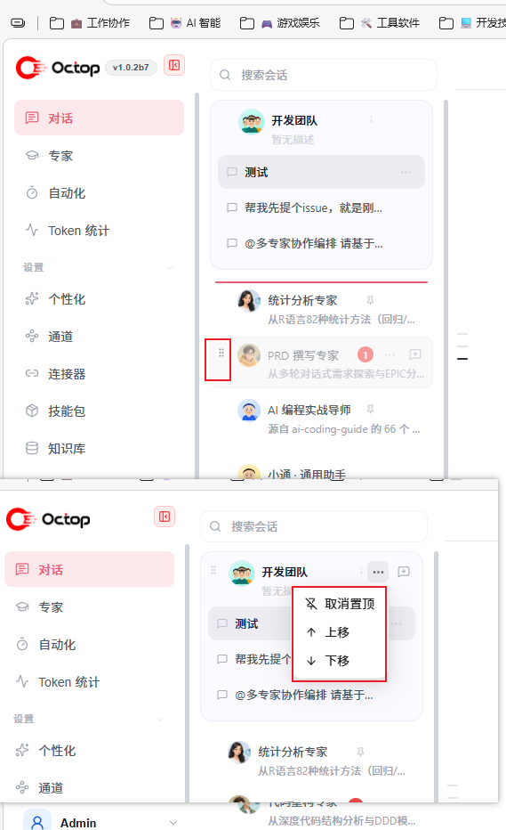

# feat(sidebar): drag-to-reorder, pin, and persist expert list order

## 需求

专家列表当前顺序固定，用户希望能够：

1. **拖拉排序** —— 直接拖动专家行改变顺序
2. **置顶** —— 把常用专家标记后固定在列表顶部
3. **跨设备保持** —— 顺序是用户偏好，不是会话级临时状态

## 实现

### 后端

新增 schema v21 迁移 `user_agent_prefs` 表（SQLite + PostgreSQL 双版本）：

| 列 | 说明 |
|---|---|
| `user_id` | 联合主键，偏好按用户隔离 |
| `agent_id` | 联合主键 |
| `pinned` | 是否置顶 |
| `sort_order` | 排序序号，`UNORDERED = -1` 表示未指定 |

`reorder` 保留置顶项不变（置顶项不参与普通排序）；`set_pin` 保留原有 `sort_order`。

API：

- `GET /agents` 返回 `pinned` 与 `sort_order`
- `POST /{id}/pin` 切换置顶
- `PUT /order` 批量重排

### 前端

- `useListOrder.ts` —— 以服务端返回为唯一真值来源（原本的 localStorage 方案已移除，否则跨设备必然不一致）
- `useDragSortReorder.ts` —— 指针拖拽排序
- `agentOrderMenu.tsx` —— 置顶/移动菜单
- 专家名加 `6em` 可读下限，徽章改为可收缩，避免长名被压成单个字

## 视觉证明

上图两处功能点：

| 位置 | 功能 |
|---|---|
| 上图 · `开发团队` 行的「⋯」 | 菜单展开，显示 `取消置顶 / 上移 / 下移`（说明该专家已置顶） |
| 下图 · `PRD 撰写专家` 行 | 左侧 ⠿ 拖拽把手，tooltip「拖拉排序」 |

说明：

- 非置顶状态下同一菜单首项为 `置顶`；`上移 / 下移` 一步一格调整位置，避免长列表必须靠拖拽
- 拖拽时行半透明，并按落点显示插入位置指示线（截图未含该中间态，可按需补）
- 把手仅在 `ordering.handleProps` 存在时渲染 —— 即排序功能开启且该行可拖拽时，隐藏专家视图与搜索态下不出现

## 测试

| 套件 | 结果 |
|---|---|
| `dashboard/src/hooks/useListOrder.test.ts` | 8 passed |
| `dashboard/src/utils/listOrder.test.ts` | 12 passed |
| `tests/unit/db/test_user_agent_prefs.py` | 9 passed |
| `tests/integration/test_agents_prefs_api.py` | 9 passed |
| `tsc --noEmit` | 0 error |

合计 38 项，全部通过。

## Reviewer 关注点

- **偏好按用户隔离**：`user_agent_prefs` 以 `(user_id, agent_id)` 为主键，A 用户的排序不影响 B 用户
- **置顶与排序的交互**：置顶项始终在顶部；重排只作用于非置顶项
- **未指定顺序的专家**：`sort_order = -1` 的排在已指定项之后，按原有默认规则（pinned / last_active / created_at）排列
- **localStorage 已移除**：原方案会与跨设备同步冲突，故以服务端为唯一真值

## 已知缺口

- **PostgreSQL 路径未验证**：`021_user_agent_prefs.pg.sql` 已提供，但测试仅覆盖 SQLite 路径
- **未覆盖场景**：多用户并发对同一 agent 列表排序的冲突处理
- **隐藏专家**是否参与排序，行为未在 UI 层显式验证

## Checklist

- [x] 📸 已提供 UI 截图/功能演示
- [x] 🧱 测试用例已添加并通过
- [x] ✅ 未改动任何 CI Workflow 配置
- [x] 🤖 已与 AI 对齐需求理解
- [x] 🎯 遵循最小修改原则（22 文件，从上游 `f79015b0` 起 cherry-pick）
- [x] 📝 已自问优化空间与异常处理，已如实列出缺口