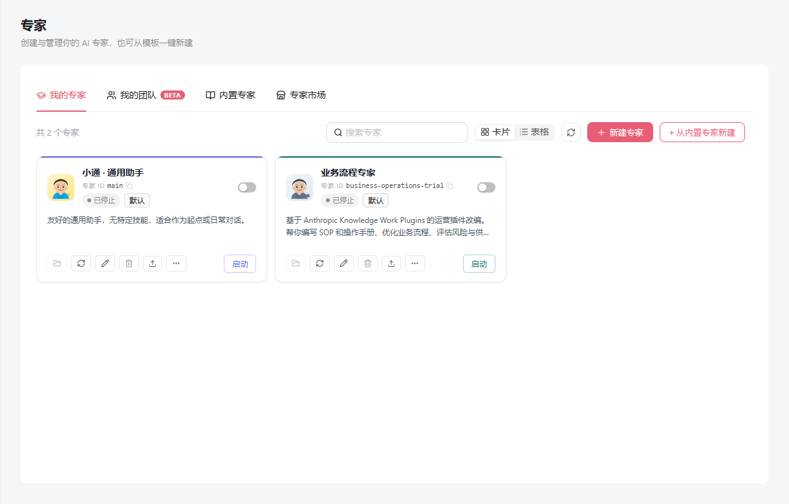
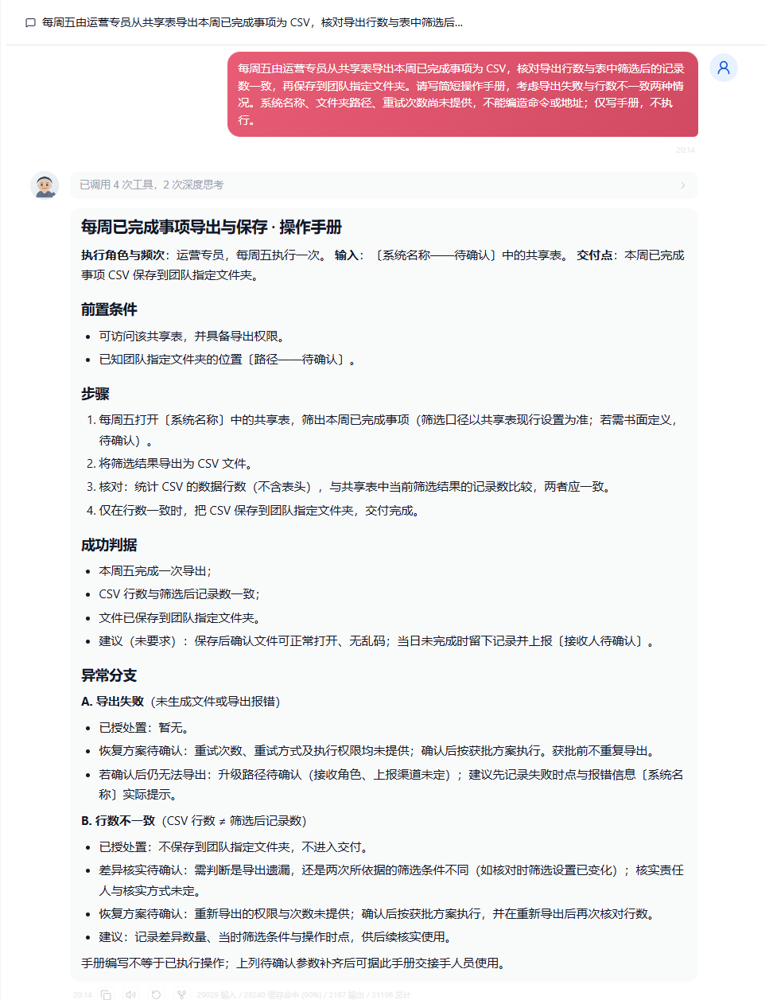

# 业务流程专家

业务流程专家把用户提供的材料整理成可审阅的业务文档。默认使用简体中文，也提供英文名称、介绍和快捷任务；没有连接器时，可以直接粘贴材料使用。

| 技能 | 交付内容 |
| --- | --- |
| SOP 编写 | 流程步骤、角色、检查点与异常分支 |
| 重复任务操作手册 | 操作步骤、成功条件、失败处理和恢复权限 |
| 流程优化 | 有依据的瓶颈判断与改进建议 |
| 风险评估 | 已知现象、潜在后果与应对建议 |
| 供应商评估 | 同口径成本、服务承诺及待确认条件 |
| 运营报告 | 进展、受阻事项、指标与待确认信息 |

## 创建与使用

在“内置专家”中选择“业务流程专家”，从模板创建后即可在“我的专家”中使用。模板创建本身不会连接 CRM、发送消息或自动安排任务。

建议提供现行流程、已知岗位、明确的检查条件，以及希望得到的成品和篇幅。未给出的权限、时限与业务事实会保留为待确认，新增措施以建议身份呈现。

## 模拟任务示例

> 每周五由运营专员从共享表导出本周已完成事项为 CSV，核对导出行数与表中筛选后的记录数一致，再保存到团队指定文件夹。请写简短操作手册，考虑导出失败与行数不一致两种情况。系统名称、文件夹路径、重试次数尚未提供，不能编造命令或地址；仅写手册，不执行。

截图来自隔离实例中的真实模型回答，材料为模拟内容。截图展示的是操作手册草稿，未实际导出 CSV、写入业务系统或对外发送。

## 验证范围

本地使用 Octop 1.0.2b8、Windows、DeepSeek `deepseek-v4-flash` 进行原生模板创建和对话验证，保留既有模型配置，没有覆盖思考模式或推理档位。

验收覆盖六项技能、首次对话与已初始化专家的新线程，以及审批职责、未知事实、恢复权限、小样本、零值指标、跨来源指标和材料内伪指令。模板契约测试覆盖目录发现、双语元数据、六项技能、许可证和原生初始化文件保留。模型输出审阅与工程测试分别记录，单次回答不构成对其他模型或所有输入的质量保证。

采用定向回归：修改的行为重跑对应场景，未受影响的已有结果经源差异复核后复用；不把较早版本的整包测试结果当作当前整包通过。

## 来源

工作方法改编自 [Anthropic Knowledge Work Plugins 的 operations 插件](https://github.com/anthropics/knowledge-work-plugins/tree/02ffa99ff00ce4d3046ccebabb8357cb39f3ab06/operations)，固定提交为 `02ffa99ff00ce4d3046ccebabb8357cb39f3ab06`。

文件来源映射、修改说明和 Apache-2.0 许可见模板目录中的 [THIRD_PARTY_NOTICES.md](../src/octop/infra/agents/experts/library/business-operations/THIRD_PARTY_NOTICES.md) 与 [LICENSE-APACHE-2.0](../src/octop/infra/agents/experts/library/business-operations/LICENSE-APACHE-2.0)。这是一份独立改编的 Octop 模板。
