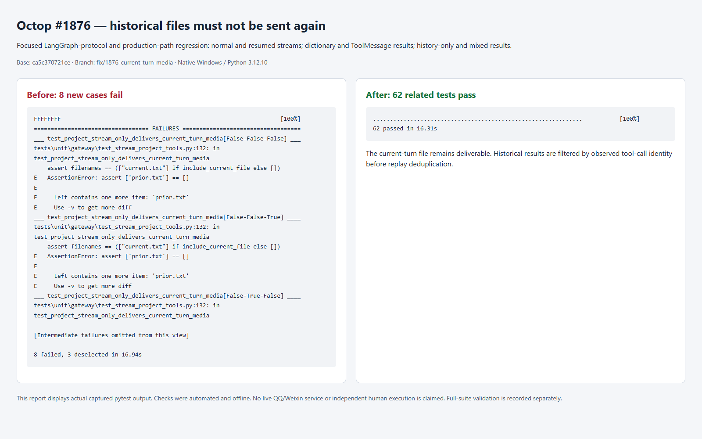

# IM history replay regression evidence

This is an automated offline regression report for #1876, captured on native Windows with Python 3.12.10. The screenshot is a browser rendering of actual saved pytest output; it is not an IM product screenshot or a live QQ/Weixin test.



## Reproduction scope

The base was `ca5c370721ce2b8dcb11d455ba1a6821769194a1` on `develop`. The new regression cases were first run against its unchanged production code: all eight failed because `prior.txt` was delivered even though its tool call was from an earlier turn.

The cases pass graph messages through the installed `LangGraphProtocol.stream` / `resume_stream` and `Overwrite` handling, then exercise `project_stream` and `project_resume_stream` with dictionary and LangChain ToolMessage results, a single historical result after an unrelated current call, and mixed historical/current results. Repeated result chunks and empty continuation IDs are included. The resume case includes a new tool call after resumption; it does not claim coverage of a paused tool returning without a new tool-call chunk.

After the fix, the eight cases and the existing related tests passed (62 total):

```sh
uv run pytest tests/unit/gateway/test_stream_project_tools.py tests/unit/gateway/test_tool_media.py tests/unit/gateway/test_hitl_channel.py -q
```

The filter uses observed current-turn tool-call IDs before the existing per-stream deduplication. Current files remain deliverable; this change does not migrate or clean stored checkpoints.

The local checks were executed by Codex. Independent human execution or live-provider validation is not claimed. Broader check results are recorded separately in the PR description.
