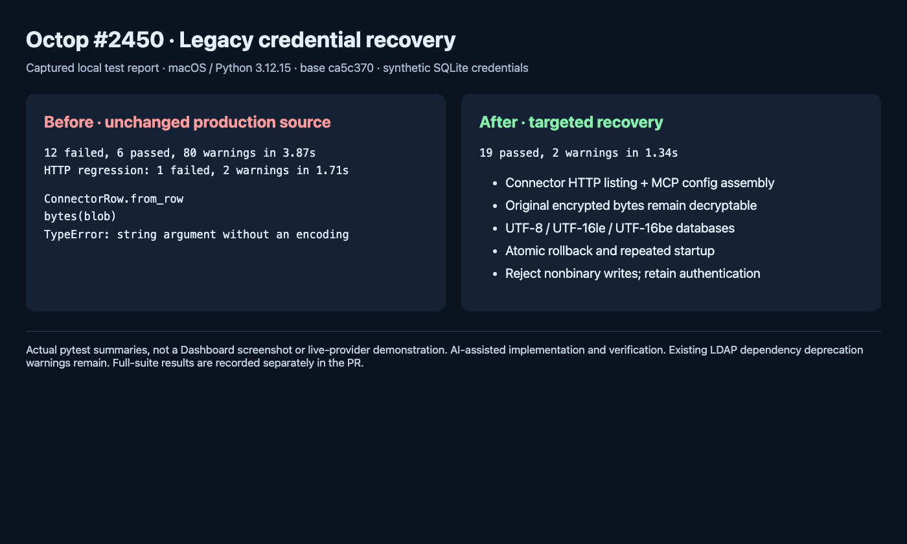

# Legacy connector credential recovery



This is a headless Chromium screenshot of the captured local pytest summaries,
using synthetic credentials and temporary SQLite databases. It is not a
Dashboard screenshot, a live-provider demonstration, or a human-review attestation.

On unchanged develop `ca5c370`, the 18 new unit cases produced **12 failures and
6 passes**; the new HTTP regression failed separately at the reported
`bytes(str)` TypeError. The original 39 custom-MCP/database tests passed.
The baseline unit run also printed pytest cleanup warnings for old host temporary
directories; subsequent runs use their own `--basetemp` directories.

With the fix, all **19 new cases pass**. The fixtures exercise the real SQLite
repo, credential encryption/decryption, connector service, MCP config assembly
and authenticated ASGI routes. The HTTP test uses the repository's offline
harness fixture and makes no external model or MCP call. The cases also cover
UTF-8/UTF-16 database encodings, all-or-nothing credential repair, repeated
startup, unchanged metadata, rejected nonbinary writes and invalid-token errors.

Reproduce on macOS/Linux/Windows with the locked dev environment:

```sh
uv run pytest tests/unit/db/test_connector_legacy_credentials.py tests/integration/test_connector_legacy_credentials.py -q
```

On macOS / Python 3.12.15, the complete ship gate
`PYTEST_ADDOPTS="--dist=loadfile" make all PYTEST_JOBS=2` passed:
**5,229 passed, 35 skipped**. Ruff lint/format and strict mypy also passed.
Whole-file worker scheduling avoids the existing CLI module-cache contamination
seen with per-case distribution; no tests were deselected beyond the Makefile's
normal non-live marker. Existing dependency deprecation warnings remain.
Native Windows, a live PostgreSQL server, vendor MCP servers and real upgrade
data were not exercised. No existing operator database was opened or modified.

The repair preserves the encrypted token bytes and every other column. It does
not infer a timezone for historical ISO timestamps, rotate keys, accept plaintext
as authenticated credentials, or make arbitrary damaged ciphertext recoverable.
